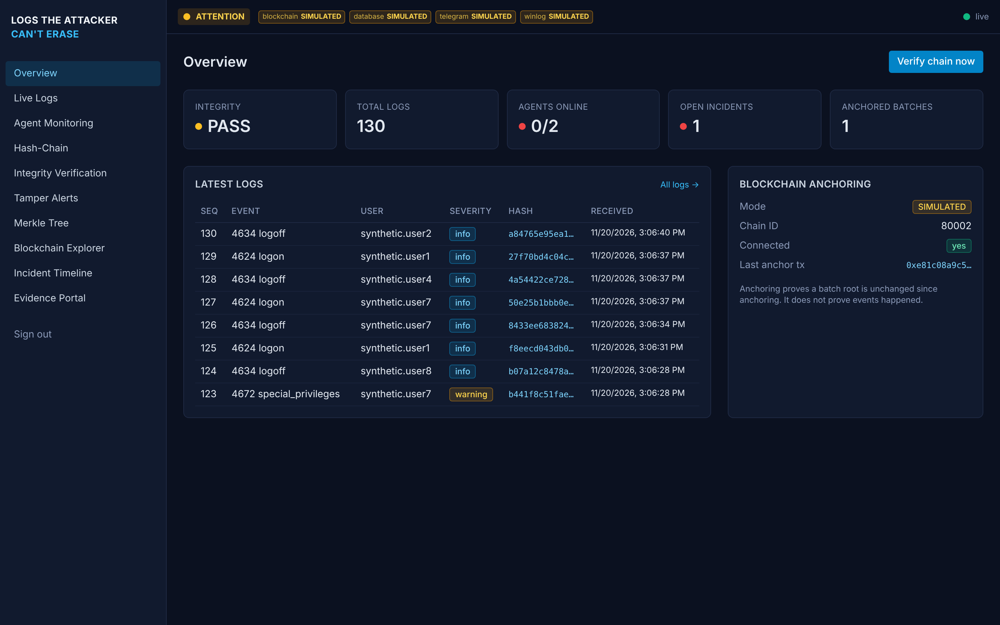

# Logs the Attacker Can't Erase

Tamper-evident security logging: **SHA-256 hash chains**, **Merkle trees** and **blockchain anchoring** on
Polygon Amoy, with a dark SOC dashboard.

> **What blockchain anchoring proves:** that an anchored Merkle root (a commitment to a batch of log hashes)
> has not changed since it was anchored.
> **What it does NOT prove:** that a logged event actually happened, that the log source was honest, or that
> logs were not altered *before* anchoring.

Every integration falls back to a simulator when its keys are empty, so the whole system runs with **zero keys**.
The dashboard shows a **REAL** or **SIMULATED** badge per integration.



## Quick start (Windows 11, PowerShell)

Prerequisites: **Python 3.12** (python.org installer, with the `py` launcher) and **Node.js 20+**.

```powershell
git clone <your-repo-url> logs-attacker-cant-erase
cd logs-attacker-cant-erase
.\start.ps1
```

`start.ps1` creates `.venv`, installs the pinned dependencies, copies `.env.example` to `.env` (SIMULATED mode),
builds the dashboard, then starts the **backend** (:8000), the **log agent** and the **dashboard** (:3000).

- Dashboard: http://127.0.0.1:3000 (login `admin` / your `API_KEY`; with an empty key in simulator mode: `dev-local-api-key`)
- API docs: http://127.0.0.1:8000/docs
- Stop: `.\start.ps1 -Stop` · Add the verifier/anchoring process: `.\start.ps1 -WithVerifier`
- If scripts are blocked: `Set-ExecutionPolicy -Scope Process -ExecutionPolicy Bypass`

Linux/macOS: `./start.sh` (same steps).

### Manual start (three terminals)

```powershell
py -3.12 -m venv .venv; .\.venv\Scripts\python.exe -m pip install -r requirements.txt
.\.venv\Scripts\python.exe -m uvicorn backend.main:app --port 8000
.\.venv\Scripts\python.exe -m backend.agent.agent --collector auto
cd frontend; npm ci; npm run build; npm run start
```

## Configuration (`.env`)

Edit `.env` yourself. It is git-ignored. Never commit it, and never paste keys into chats or tickets.

| Variable | Default | Purpose |
|---|---|---|
| `MODE` | `simulator` | `real` refuses to start unless `API_KEY` and `JWT_SECRET` are set |
| `API_KEY` | *(empty → dev key in simulator)* | Agent → API key (`X-API-Key`) and dashboard password |
| `JWT_SECRET` | *(empty → random per start)* | Signs dashboard JWTs |
| `DATABASE_URL` | `sqlite:///./local.db` | SQLite, or Supabase Postgres |
| `AMOY_RPC_URL`, `ANCHOR_PRIVATE_KEY`, `CONTRACT_ADDRESS`, `CHAIN_ID=80002` | empty | Polygon Amoy anchoring |
| `TELEGRAM_BOT_TOKEN`, `TELEGRAM_CHAT_ID` | empty | Incident alerts |

Generate the two local secrets (PowerShell):

```powershell
.\.venv\Scripts\python.exe -c "import secrets; print('API_KEY=' + secrets.token_urlsafe(32)); print('JWT_SECRET=' + secrets.token_urlsafe(48))"
```

### 1. Polygon Amoy (blockchain anchoring)

Use a **throwaway testnet wallet only**.

1. Create a new wallet (e.g. a fresh MetaMask account used for nothing else). Export its private key into `.env`
   as `ANCHOR_PRIVATE_KEY=0x…`.
2. Get test POL from a Polygon Amoy faucet.
3. Get an RPC URL (public `https://rpc-amoy.polygon.technology` or a provider such as Alchemy/Infura) → `AMOY_RPC_URL=`.
4. Deploy the contract:
   ```powershell
   cd smart-contracts; npm ci; npx hardhat test; npm run deploy:amoy
   ```
   It prints the contract address and a PolygonScan link (never the key). Put the address in `.env` as `CONTRACT_ADDRESS=`.
5. Restart. The **blockchain** badge turns **REAL**. Anchors then show an `amoy.polygonscan.com/tx/…` link, and
   `POST /api/proof/verify` reads the root back from the contract (`getAnchor(onchain_batch_id)`).

The contract `LogAnchor.sol` is **write-once per batch** and **owner-only**, and emits
`RootAnchored(batchId, root, timestamp, submitter)`. The compiler is the pinned npm `solc@0.8.24`, so no
compiler download is needed.

### 2. Supabase Postgres (database)

1. Create a Supabase project → **SQL Editor** → run `backend/database/schema_postgres.sql`, then
   `backend/database/roles_postgres.sql` (set the role password inside the editor).
2. **Project Settings → Database → Connection string (URI)** → `DATABASE_URL=postgresql://…`
3. Restart. The **database** badge turns **REAL**. Details: [`documentation/DATABASE.md`](documentation/DATABASE.md).

### 3. Telegram (incident alerts)

1. Talk to **@BotFather** → `/newbot` → copy the token into `TELEGRAM_BOT_TOKEN=`.
2. Send any message to your bot, then open `https://api.telegram.org/bot<token>/getUpdates` in a browser and copy
   `message.chat.id` into `TELEGRAM_CHAT_ID=`.
3. Restart. The **telegram** badge turns **REAL**. If Telegram fails, alerts fall back to the console (token never logged).

### 4. Windows Event Log (log collection)

No key. On Windows with `pywin32` installed (it is in `requirements.txt` for Windows), the agent reads the
**Security** log events 4624/4634/4672/4673 **read-only**. Reading the Security log needs an **elevated**
PowerShell. Without pywin32 or rights, the agent falls back to the synthetic event simulator automatically.

### 5. PolygonScan Amoy (explorer links)

No key. Links are built from the tx hash (`https://amoy.polygonscan.com/tx/<hash>`) and shown on the
Blockchain Explorer page in REAL mode.

## Tests

```powershell
.\.venv\Scripts\python.exe -m pytest              # 99 tests (Postgres/Hardhat tests skip unless configured)
cd smart-contracts; npx hardhat test              # 5 contract tests
cd frontend; npm run lint; npm run typecheck; npm run build
```

Optional: `PG_TEST_URL=postgresql://…` (throwaway DB) runs the Postgres schema and role test.
`HARDHAT_RPC_URL`/`HARDHAT_TEST_KEY`/`HARDHAT_CONTRACT` run the real web3.py path against a local Hardhat node.

## Verify evidence offline

```powershell
.\.venv\Scripts\python.exe -m backend.crypto.offline_verify evidence_batch_1.json
```

It uses only the Python standard library and checks every log hash, chain link, the Merkle root, every inclusion
proof, and that the root equals the anchored root.

## Documentation

- [Architecture and trust model](documentation/ARCHITECTURE.md)
- [API reference](documentation/API.md) · [OpenAPI spec](documentation/openapi.json) · full contract in [`PROJECT_STATE.md`](PROJECT_STATE.md)
- [Database](documentation/DATABASE.md)
- [2-minute demo script](documentation/DEMO_SCRIPT.md)
- [Screenshots](documentation/screenshots/)

## Known limitations

- The demo dashboard login is `admin` + `API_KEY` (one shared secret). Replace it with real user accounts before production.
- The hash chain alone cannot detect deletion of the newest logs or a full recompute of the chain. Anchoring covers this **only after** a batch is anchored.
- The simulated chain is a local JSON file, not a blockchain. Only REAL mode gives an external, independent anchor.
- Sequential `seq_id` relies on a per-process lock: run a single backend worker.
- `/api/logs` search uses `LIKE`. Fine for demo volumes, not for millions of rows.
