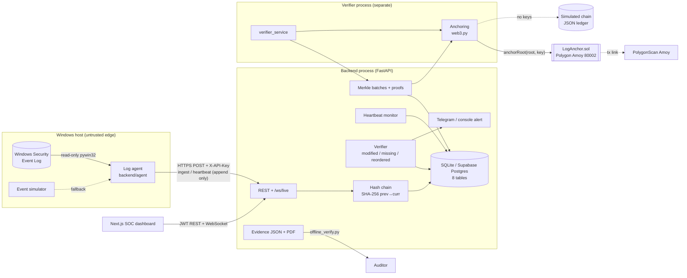

# Architecture

## Trust model

| Layer | Detects | Does not detect |
|---|---|---|
| Hash chain (`prev_hash`→`curr_hash`) | Edited, deleted (gap), reordered, delete-and-renumber logs | An attacker who edits a log **and recomputes every later hash**; deleting the newest logs (tail truncation) |
| Merkle root per batch | Any change to a log in the batch, count changes | Changes before the batch was built |
| On-chain anchor (write-once, owner-only) | Full chain rewrites and tail truncation after anchoring (root MISMATCH) | Tampering **before** anchoring; whether the events happened; a dishonest log source |
| Restricted DB role `log_writer` | Blocks UPDATE/DELETE/TRUNCATE for the ingest credential | A DB superuser |

**Blockchain anchoring proves only that an anchored commitment has not changed since anchoring. It does not prove an event happened.**

## Data flow

1. Agent reads 4624/4634/4672/4673 (or simulates) → `POST /api/logs/ingest` with `X-API-Key`; heartbeat every 10 s.
2. Ingest (single-process lock) assigns `seq_id = last + 1`, computes `curr_hash = SHA-256(prev_hash ‖ canonical_json(log))`, stores log + link, and pushes the log on `/ws/live`.
3. `POST /api/verify` (or the verifier process) recomputes the chain; each issue → `incidents` row + alert.
4. `POST /api/merkle/build` freezes unbatched logs into a batch (leaf = `SHA-256(0x00‖curr_hash)`).
5. `POST /api/blockchain/anchor` writes the root on-chain under `onchain_batch_id = (genesis_hash[:64 bits] << 64) | batch_id`.
6. `POST /api/proof/verify` **recomputes leaves from log content** and compares with the on-chain root → MATCH / MISMATCH.
7. `GET /api/evidence/{id}/json|pdf` exports a self-contained bundle that `offline_verify.py` checks with the standard library only.

## Processes

| Process | Command | Notes |
|---|---|---|
| Backend | `python -m uvicorn backend.main:app` | run **one** worker (seq_id lock is per process) |
| Agent | `python -m backend.agent.agent` | no update/delete code path |
| Verifier | `python -m backend.verifier_service` | separate from the agent; optional (`start.ps1 -WithVerifier`) |
| Dashboard | `npm run start` in `frontend/` | Next.js 14 |
